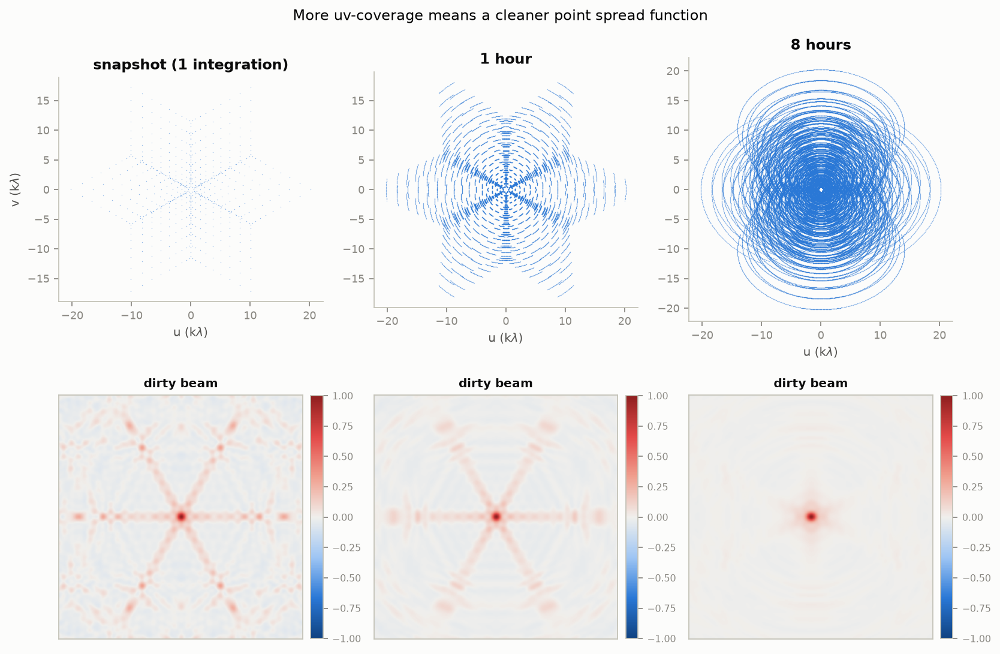
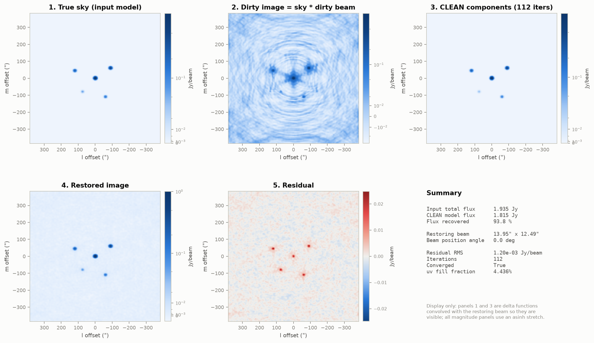
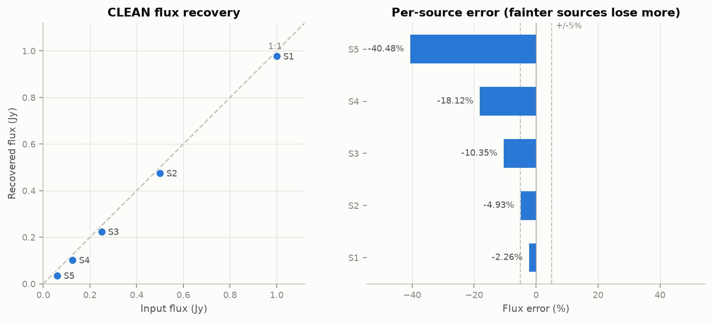
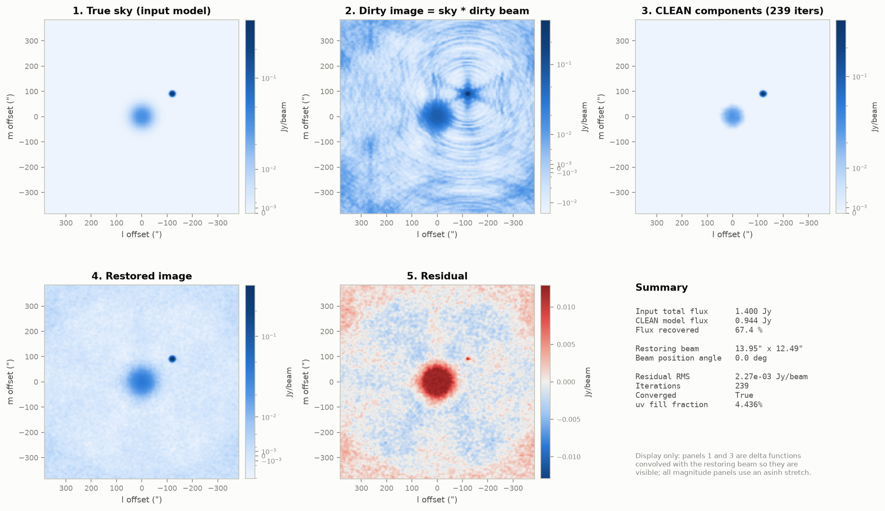

# apsynth — a self-validating aperture synthesis simulator

A minimal, readable implementation of how a radio interferometer turns antenna
signals into an image: **array layout → uv-coverage → dirty image → Högbom CLEAN**,
with the physics checked by tests rather than asserted in a comment.

Pure `numpy`/`scipy`/`astropy`. No CASA, no casacore, no Linux-only dependencies.
Runs anywhere Python does, in about 90 seconds.

```bash
pip install -e ".[dev]"
python scripts/run_demo.py     # writes figures/ and results/
pytest                         # 44 tests
```

---

## Why this exists

Radio interferometry has one idea at its centre that is genuinely hard to absorb
from a textbook: **a telescope array does not take a picture. It measures
scattered samples of the Fourier transform of the sky, and the image has to be
reconstructed from them.**

This package exists to make that idea concrete and *checkable*. Every stage is
short enough to read in one sitting, and the parts that could be subtly wrong
are pinned down by tests — which matters, because in this field a normalisation
error produces an image that looks perfectly plausible and is quantitatively
worthless.

It is not a production imager. [WSClean](https://wsclean.readthedocs.io/) exists
and is excellent. This is for understanding what WSClean is doing.

---

## The physics, briefly

**One pair of antennas measures one complex Fourier component of the sky.** Which
component depends on the vector between them, projected onto the plane
perpendicular to where you are pointing. That measurement is called a *visibility*,
and the formal statement is the van Cittert–Zernike theorem:

$$V(u,v) = \iint I(l,m)\, e^{-2\pi i (ul + vm)} \, dl \, dm$$

`N` antennas give `N(N−1)/2` pairs, so 27 antennas give 351 samples per
integration. Still a desperately sparse sampling of a 2D Fourier plane — in the
demo configuration, **4.4% of uv cells are occupied**.

**The Earth rotates, which is free extra coverage.** As the sky moves overhead,
the projected baseline changes, so each antenna pair sweeps an arc through the
Fourier plane. Eight hours of this turns 351 points into 84,240. This is *earth
rotation synthesis*, and `figures/03_coverage_comparison.png` shows exactly what
it buys you.



*Snapshot, one hour, eight hours — and the point spread function each produces.
More Fourier coverage means fewer sidelobes to deconvolve.*

**Inverse-FFT the samples and you get the "dirty image"** — the true sky
convolved with the point spread function of your sampling pattern (the "dirty
beam"), which is covered in sidelobes because the sampling is sparse. The
identity

$$\text{dirty image} = \text{sky} * \text{dirty beam}$$

is what makes the problem solvable, and it is asserted to floating-point
precision in `tests/test_imaging.py::test_dirty_image_is_sky_convolved_with_beam`.
If that test fails, nothing else in the repository means anything.

**CLEAN undoes the convolution** by assuming the sky is mostly empty: find the
brightest peak, subtract a scaled dirty beam, record a delta function, repeat.
ML readers will recognise this immediately — it is matching pursuit / greedy
sparse deconvolution, published by Högbom in 1974, two decades before those
names existed. The sparsity prior is "the sky is mostly blank," which is true
for fields of compact sources and false for extended emission. Run C below shows
what happens when it is false.

---

## Results

Configuration: VLA-like Y array, 27 antennas, 4.3 km longest baseline, 1.4 GHz,
declination +45°, 240 integrations over 8 hours, 512² image at 1.5″/pixel.
Fitted restoring beam **13.95″ × 12.49″**.



*Truth → dirty image → CLEAN components → restored → residual. The red remnants
in panel 5 sit exactly on the sources: that is the un-cleaned flux the table
below quantifies.*

### Does the algorithm conserve flux?

Noiseless field, cleaned deep. This isolates the question "is the implementation
correct?" from "where should you stop cleaning?".

| Source | Input (Jy) | Recovered (Jy) | Error |
|---|---|---|---|
| S1 | 1.000 | 1.000 | −0.04 % |
| S2 | 0.500 | 0.500 | −0.08 % |
| S3 | 0.250 | 0.250 | −0.16 % |
| S4 | 0.125 | 0.125 | −0.31 % |
| S5 | 0.060 | 0.060 | −0.64 % |
| **Total** | **1.935** | **1.933** | **−0.10 %** |

Yes. Flux is conserved to 0.1% overall, with the residual sub-percent errors
tracking source faintness exactly as the next section predicts.

### What it costs on realistic data

Same field with thermal noise, cleaned to 3σ — what you would actually do.

| Source | Input (Jy) | Recovered (Jy) | Error |
|---|---|---|---|
| S1 | 1.000 | 0.977 | −2.26 % |
| S2 | 0.500 | 0.475 | −4.93 % |
| S3 | 0.250 | 0.224 | −10.35 % |
| S4 | 0.125 | 0.102 | −18.12 % |
| S5 | 0.060 | 0.036 | **−40.48 %** |

**Dynamic range 120 → 1033.** Residual RMS 1.2 mJy/beam. 112 iterations.



The faintest source loses 40% of its flux. That is not a bug — it is the most
useful thing in this repository. CLEAN stops when the residual peak falls below
the threshold, leaving roughly `threshold` worth of flux under *every* source.
The deficit is **absolute**, so as a **fraction** it savages faint sources and
barely touches bright ones. Anyone using a radio source catalogue near its
detection limit is looking at fluxes biased low by this effect.

`tests/test_clean.py::test_shallow_cleaning_leaves_flux_behind` asserts the
effect exists and that it is worse for fainter sources.

### Where CLEAN fails

Run C puts a 70″ Gaussian (1.0 Jy) beside a compact source (0.4 Jy).
**CLEAN recovers 67.4% of the flux.** Two things go wrong at once: delta
functions are a bad basis for smooth emission, and the array has no short
baselines, so large-scale structure was never measured in the first place — it
is *resolved out*, and no amount of deconvolution invents it back. This is why
multi-scale CLEAN exists, and why single-dish data gets combined with
interferometer data.



### Figures

| | |
|---|---|
| `01_array_layout.png` | antenna positions |
| `02_uv_coverage.png` | the Fourier samples actually measured |
| `03_coverage_comparison.png` | **snapshot vs 1 h vs 8 h, and the beam each produces** |
| `04_dirty_beam.png` | PSF image and a cut showing sidelobe level |
| `05_clean_summary.png` | **truth → dirty → components → restored → residual** |
| `06_flux_recovery.png` | input vs recovered flux, per-source error |
| `07_convergence.png` | residual peak against iteration |
| `08_extended_source.png` | the extended-emission failure case |

---

## What is actually verified

44 tests. The ones that matter:

| Test | Guards against |
|---|---|
| `test_dirty_image_is_sky_convolved_with_beam` | wrong FFT convention or normalisation — the foundation of everything |
| `test_beam_has_unit_peak_at_centre` | Jy/beam scale being silently wrong |
| `test_point_source_peak_equals_its_flux` | the Jy/pixel ↔ Jy/beam unit convention |
| `test_clean_recovers_input_fluxes` | a deconvolver that makes pretty images with wrong photometry |
| `test_clean_components_are_not_scattered_off_the_source` | flux numbers being an artefact of aperture choice |
| `test_shallow_cleaning_leaves_flux_behind` | the photometric bias above, pinned as expected behaviour |
| `test_uvw_rotation_preserves_baseline_length` | a sign or transpose error in the uvw rotation |
| `test_sampling_function_is_hermitian` | a complex dirty image from a mis-indexed conjugate |
| `test_samples_outside_the_grid_warn_rather_than_vanish` | silently dropping long baselines and losing resolution |
| `test_robust_rms_ignores_bright_sources` | noise estimates dragged up by real signal |

---

## Conventions

Getting these wrong produces results that are wrong but look fine.

- **Images are centred**: zero spatial frequency and the field centre both sit at
  index `n_pix // 2`. `fftshift`/`ifftshift` pairs convert to numpy's ordering.
- **Arrays are indexed `[row, col] = [m, l]`**, and visibility grids `[v, u]`.
- **Sky models are Jy/pixel. Images are Jy/beam.** Converting between them needs
  the beam area (`metrics.beam_area_pixels`) — a classic source of wrong answers.
- **uv grid spacing is `1/(n_pix × cell)`**, reaching `±1/(2 × cell)`. A wider
  field means finer uv sampling; smaller pixels reach longer baselines. If your
  longest baseline falls off the grid you are throwing data away, so
  `grid_samples` warns loudly instead of dropping it quietly.
- **Angles are `astropy.units` quantities.** Passing a bare number raises.

---

## Simplifications, stated plainly

Every one of these is a real thing production software handles and this does not.

| Simplification | Consequence |
|---|---|
| **`w` term ignored** (narrow-field approximation) | valid only for small fields; wide-field imaging needs w-projection or w-stacking. The `w` coordinate *is* computed, just unused when imaging. |
| **Nearest-cell gridding** | production imagers convolve onto several cells with a prolate spheroidal kernel to suppress aliasing |
| **No calibration** | visibilities are perfect. Real data needs gain, bandpass and direction-dependent calibration, which is most of the actual work |
| **Monochromatic** | no multi-frequency synthesis, no spectral index fitting |
| **Natural weighting only** | no uniform or Briggs/robust weighting |
| **Flat array, no primary beam** | no elevation-dependent effects, no primary beam attenuation across the field |
| **Högbom only** | no Clark/Cotton-Schwab acceleration, no multi-scale CLEAN (which is what Run C needs) |
| **Gaussian noise** | real noise is not stationary and RFI is not Gaussian at all |

---

## Layout

```
src/apsynth/
  arrays.py       antenna layouts (Y, east-west, circular, random)
  uvcoverage.py   ENU→XYZ, baselines, uvw rotation, earth rotation synthesis
  sky.py          point and Gaussian source models, Jy/pixel
  imaging.py      gridding, dirty image, dirty beam  ← the core identity
  clean.py        Högbom CLEAN, restoring beam fit
  metrics.py      flux recovery, dynamic range, robust RMS
  plotting.py     figures
tests/            44 tests
scripts/run_demo.py
```

---

## Next

Built as a foundation exercise while moving from ML engineering into radio
astronomy. The intuition here — sparse Fourier sampling, PSF deconvolution,
flux conservation, and the gap between a clean simulation and real data — is
what the harder problems (RFI flagging, SKA source finding, learned imaging)
all rest on.

Natural extensions: w-projection for wide fields, Briggs/robust weighting,
multi-scale CLEAN for the extended-emission case above, and reading real
visibilities from a Measurement Set instead of simulating them.

## References

- Högbom, J. A. 1974, A&AS, 15, 417 — the original CLEAN paper
- Condon & Ransom, *Essential Radio Astronomy* (NRAO, free online)
- Thompson, Moran & Swenson, *Interferometry and Synthesis in Radio Astronomy*,
  3rd ed. — the uvw rotation here is their eq. 4.1

MIT licensed.
